# Architecture diagram

The overall architecture of XFOIL's viscous-inviscid coupling method, as a diagram and in outline.

## The diagram

```mermaid
%%{init: {'theme': 'base', 'themeVariables': { 'primaryColor': '#e1f5fe', 'primaryBorderColor': '#01579b', 'lineColor': '#01579b'}}}%%
flowchart TB
    subgraph INPUT["Input"]
        geom["Geometry<br/>(X, Y coordinates)"]
        cond["Conditions<br/>(α, Re, M∞)"]
    end

    subgraph GEOM["Geometry Setup"]
        pangen["PANGEN<br/>Repanel"]
        spline["SPLINE<br/>Compute coefficients"]
        tecalc["TECALC<br/>TE geometry"]
    end

    subgraph INVISCID["Inviscid Solution"]
        psilin["PSILIN<br/>Influence coefficients"]
        setup["SETUP<br/>Factor AIJ matrix"]
        gamcalc["GAMCALC<br/>Solve for γ"]
        qinv["QINV<br/>Tangential velocity"]
    end

    subgraph VISCAL["VISCAL - Coupling Loop"]
        direction TB

        subgraph SETUP_SUB["Setup"]
            xywake["XYWAKE<br/>Wake trajectory"]
            qdcalc["QDCALC<br/>DIJ matrix"]
            stfind["STFIND<br/>Stagnation point"]
        end

        subgraph NEWTON["Newton Iteration"]
            setbl["SETBL<br/>Fill system"]
            blsolv["BLSOLV<br/>Block solve"]
            update["UPDATE<br/>Apply deltas"]
        end

        subgraph BL_DETAIL["BL Station Processing"]
            blprv["BLPRV<br/>Primary variables"]
            blkin["BLKIN<br/>Secondary variables"]
            blvar["BLVAR<br/>Closure relations"]
            blsys["BLSYS<br/>Local system"]
            trchek["TRCHEK<br/>Transition"]
        end

        subgraph VEL_UPDATE["Velocity Update"]
            qvfue["QVFUE<br/>Qvis from mass defect"]
            gamqv["GAMQV<br/>γ from Qvis"]
            stmove["STMOVE<br/>Move stagnation"]
        end
    end

    subgraph FORCES["Force Calculation"]
        clcalc["CLCALC<br/>CL, CM"]
        cdcalc["CDCALC<br/>CD"]
    end

    subgraph OUTPUT["Output"]
        coeffs["CL, CD, CM"]
        cp["Cp distribution"]
        bl["BL parameters<br/>δ*, θ, Cf, H"]
        trans["Transition<br/>locations"]
    end

    %% Main flow
    INPUT --> GEOM
    GEOM --> INVISCID
    INVISCID --> VISCAL

    %% Geometry flow
    geom --> pangen
    cond --> pangen
    pangen --> spline
    spline --> tecalc

    %% Inviscid flow
    tecalc --> psilin
    psilin --> setup
    setup --> gamcalc
    gamcalc --> qinv

    %% VISCAL setup
    qinv --> xywake
    qinv --> qdcalc
    qinv --> stfind

    %% Newton loop
    xywake --> setbl
    qdcalc --> setbl
    stfind --> setbl

    %% BL processing within SETBL
    setbl --> blprv
    blprv --> blkin
    blkin --> blvar
    blvar --> blsys
    blsys --> trchek
    trchek --> blsolv

    %% Newton iteration
    blsolv --> update
    update --> qvfue
    qvfue --> gamqv
    gamqv --> stmove

    %% Convergence check
    stmove --> conv{RMSBL < 1e-4?}
    conv -->|No| setbl
    conv -->|Yes| FORCES

    %% Force calculation
    FORCES --> clcalc
    FORCES --> cdcalc

    %% Output
    clcalc --> coeffs
    cdcalc --> coeffs
    clcalc --> cp
    cdcalc --> bl
    blsolv --> trans

    %% Styling
    classDef inputOutput fill:#e8f5e9,stroke:#2e7d32
    classDef geomStyle fill:#fff3e0,stroke:#e65100
    classDef inviscidStyle fill:#e3f2fd,stroke:#1565c0
    classDef viscalStyle fill:#fce4ec,stroke:#c2185b
    classDef blStyle fill:#f3e5f5,stroke:#7b1fa2
    classDef forceStyle fill:#e0f2f1,stroke:#00695c

    class INPUT,OUTPUT inputOutput
    class GEOM geomStyle
    class INVISCID inviscidStyle
    class VISCAL viscalStyle
    class BL_DETAIL blStyle
    class FORCES forceStyle
```



## The three parts of the method

XFOIL solves the 2D viscous airfoil problem using:

1. **Panel Method** - Linear vortex panels for inviscid flow
2. **Integral Boundary Layer** - 3-equation integral BL with e^N transition
3. **Viscous-Inviscid Coupling** - Semi-inverse Newton iteration

## Solution Flow

```
┌─────────────────────────────────────────────────────────────────┐
│                        INPUT                                    │
│  Geometry: X, Y coordinates                                     │
│  Conditions: α (or CL), Re, M∞                                  │
└─────────────────────────────────────────────────────────────────┘
                              │
                              ▼
┌─────────────────────────────────────────────────────────────────┐
│                     GEOMETRY SETUP                              │
│  PANGEN: Repanel airfoil to N panels                            │
│  SPLINE: Compute spline coefficients for X(S), Y(S)             │
│  TECALC: Calculate TE geometry (sharp or blunt)                 │
└─────────────────────────────────────────────────────────────────┘
                              │
                              ▼
┌─────────────────────────────────────────────────────────────────┐
│                   INVISCID SOLUTION                             │
│  PSILIN: Compute vortex influence coefficients AIJ              │
│  SETUP: Factor AIJ matrix (LU decomposition)                    │
│  GAMCALC: Solve [AIJ]{γ} = {RHS} for vortex strengths           │
│  QINV: Tangential velocity from vortex distribution             │
└─────────────────────────────────────────────────────────────────┘
                              │
                              ▼
┌─────────────────────────────────────────────────────────────────┐
│                      VISCAL                                     │
│  Main viscous-inviscid coupling loop                            │
└─────────────────────────────────────────────────────────────────┘
         │                    │                    │
         ▼                    ▼                    ▼
┌─────────────────┐  ┌─────────────────┐  ┌─────────────────┐
│   WAKE SETUP    │  │   DIJ MATRIX    │  │   BL SETUP      │
│                 │  │                 │  │                 │
│ XYWAKE: Compute │  │ QDCALC: Source  │  │ STFIND: Locate  │
│ wake trajectory │  │ influence on    │  │ stagnation pt   │
│ from TE         │  │ tangential      │  │                 │
│                 │  │ velocity        │  │ IBLPAN: Set     │
│ QWCALC: Set     │  │                 │  │ BL→panel ptrs   │
│ wake velocities │  │ DIJ(i,j) =      │  │                 │
│                 │  │ ∂Qtan_i/∂σ_j    │  │ XICALC: Arc     │
└─────────────────┘  └─────────────────┘  │ length coords   │
                                          └─────────────────┘
                              │
                              ▼
         ┌────────────────────────────────────────┐
         │         NEWTON ITERATION LOOP          │
         │         (ITER = 1 to ITMAX)            │
         └────────────────────────────────────────┘
                              │
         ┌────────────────────┴────────────────────┐
         ▼                                         ▼
┌─────────────────────────┐           ┌─────────────────────────┐
│       SETBL             │           │       BLSOLV            │
│                         │           │                         │
│ Fill Newton system      │           │ Block tri-diagonal      │
│ for BL variables        │           │ solution with           │
│                         │           │ underrelaxation         │
│ For each BL station:    │           │                         │
│ ├─ BLPRV: Primary vars  │           │ Solve:                  │
│ ├─ BLKIN: Secondary     │           │ [VA VB] [Δ] = [VDEL]    │
│ ├─ BLVAR: Closures      │           │                         │
│ ├─ BLSYS: Local system  │           └─────────────────────────┘
│ └─ TRCHEK: Transition   │
└─────────────────────────┘
                              │
                              ▼
┌─────────────────────────────────────────────────────────────────┐
│                        UPDATE                                   │
│  Apply Newton deltas with underrelaxation                       │
│  Update: CTAU, THET, DSTR, UEDG, MASS                           │
│  Enforce bounds: Hk > 1, Ctau > 0                               │
└─────────────────────────────────────────────────────────────────┘
                              │
                              ▼
┌─────────────────────────────────────────────────────────────────┐
│                    VELOCITY UPDATE                              │
│  QVFUE: Compute QVIS from mass defect                           │
│         QVIS_i = QINV_i + Σ_j DIJ(i,j)·σ_j                      │
│  GAMQV: Set γ from QVIS                                         │
│  STMOVE: Relocate stagnation point                              │
└─────────────────────────────────────────────────────────────────┘
                              │
                              ▼
┌─────────────────────────────────────────────────────────────────┐
│                  FORCE CALCULATION                              │
│  CLCALC: Integrate Cp → CL, CM                                  │
│  CDCALC: CD from momentum deficit                               │
└─────────────────────────────────────────────────────────────────┘
                              │
                              ▼
                    ┌─────────────────┐
                    │ RMSBL < 1e-4 ?  │
                    └─────────────────┘
                     │ No          │ Yes
                     │             │
         ┌───────────┘             └───────────┐
         ▼                                     ▼
    Next iteration                      ┌───────────┐
                                        │ CONVERGED │
                                        └───────────┘
                                               │
                                               ▼
┌─────────────────────────────────────────────────────────────────┐
│                          OUTPUT                                 │
│  CL, CD, CM coefficients                                        │
│  Cp distribution                                                │
│  BL parameters: δ*, θ, Cf, H                                    │
│  Transition locations                                           │
└─────────────────────────────────────────────────────────────────┘
```

## Boundary Layer Solution Detail

```
SETBL / MRCHDU Flow:

Station 1 (upstream)              Station 2 (downstream)
       │                                   │
       ▼                                   ▼
┌─────────────┐                    ┌─────────────┐
│   BLPRV     │                    │   BLPRV     │
│ Set primary │                    │ Set primary │
│ variables   │                    │ variables   │
└─────────────┘                    └─────────────┘
       │                                   │
       ▼                                   ▼
┌─────────────┐                    ┌─────────────┐
│   BLKIN     │                    │   BLKIN     │
│ M, ρ, Hk    │                    │ M, ρ, Hk    │
│ Re_θ        │                    │ Re_θ        │
└─────────────┘                    └─────────────┘
       │                                   │
       ▼                                   ▼
┌─────────────┐                    ┌─────────────┐
│   BLVAR     │                    │   BLVAR     │
│ H*, Cf, DI  │                    │ H*, Cf, DI  │
│ Closures    │                    │ Closures    │
└─────────────┘                    └─────────────┘
       │                                   │
       └──────────────┬────────────────────┘
                      ▼
              ┌─────────────┐
              │   BLSYS     │
              │ Assemble    │
              │ 4×4 system  │
              └─────────────┘
                      │
                      ▼
              ┌─────────────┐
              │  TRCHEK     │
              │ Transition? │
              └─────────────┘
                     │
           ┌─────────┴─────────┐
           ▼                   ▼
      [Laminar]           [Turbulent]
      Amplification       Shear stress
      equation            lag equation
```

## Key Data Structures

### Panel Method
```
AIJ(N,N)     Vortex influence matrix: dψ/dγ
DIJ(N+NW,N+NW)  Source influence matrix: dQtan/dσ
GAM(N)       Vortex strengths
SIG(N+NW)    Source strengths (mass defect)
QINV(N+NW)   Inviscid tangential velocity
QVIS(N+NW)   Viscous tangential velocity
```

### Boundary Layer
```
UEDG(IVX,2)  Edge velocity
DSTR(IVX,2)  Displacement thickness δ*
THET(IVX,2)  Momentum thickness θ
CTAU(IVX,2)  Shear coefficient or amplification
MASS(IVX,2)  Mass defect = Ue·δ*
```

### Newton System
```
VA(3,2,N)    Diagonal blocks
VB(3,2,N)    Off-diagonal blocks
VDEL(3,2,N)  Residual/solution vectors
VM(3,N,N)    Mass influence vectors
```

## Coupling Mechanism

The viscous-inviscid interaction is handled through:

1. **Mass defect equivalence**:
   ```
   σ = d(ρ·Ue·δ*)/ds
   ```
   BL displacement thickness creates equivalent source distribution.

2. **Source influence**:
   ```
   Qvis = Qinv + DIJ·σ
   ```
   Sources modify surface velocity.

3. **Edge velocity feedback**:
   ```
   Ue = |Qvis|
   ```
   Modified velocity becomes new BL edge condition.

4. **Newton iteration**:
   Simultaneous update of BL variables and flow field.

## Transition Model

The e^N method:
```
dN/ds = f(Hk, Re_θ)  [Drela-Giles correlation]

Transition when: N > N_crit (typically 9)
```

The amplification rate f depends on:
- Kinematic shape factor Hk
- Momentum thickness Reynolds number Re_θ
- Pressure gradient (implicit in Hk)

## Data flow through the routines

```
Input Geometry (X, Y coordinates)
        │
        ▼
┌───────────────────┐
│   PANGEN          │  Repanel airfoil
│   (xgeom.f)       │
└───────────────────┘
        │
        ▼
┌───────────────────┐
│   SPECAL          │  Specify alpha
│   (xoper.f)       │
└───────────────────┘
        │
        ▼
┌───────────────────┐
│   Panel Method    │  Solve inviscid flow
│   (xpanel.f)      │  → GAM, QINV
└───────────────────┘
        │
        ▼
┌───────────────────┐
│   VISCAL          │  Viscous-inviscid coupling
│   (xoper.f)       │
│   ┌─────────────┐ │
│   │ SETBL       │ │  Initialize BL
│   └─────────────┘ │
│   ┌─────────────┐ │
│   │ MRCHUE      │ │  March BL equations
│   │ (xbl.f)     │ │  → DSTR, THET
│   └─────────────┘ │
│   ┌─────────────┐ │
│   │ UPDATE      │ │  Mass defect → source
│   │ (xbl.f)     │ │  → SIG
│   └─────────────┘ │
│   ┌─────────────┐ │
│   │ QDCALC      │ │  Update Qvis
│   └─────────────┘ │
│         ↑         │
│         └─────────│  Iterate until converged
└───────────────────┘
        │
        ▼
┌───────────────────┐
│   Force Coeffs    │  CL, CD, CM
└───────────────────┘
```

## Regenerating the diagram's PDF

The diagram above is `architecture-diagram/architecture.mmd`; a PDF of it, [`architecture.pdf`](architecture-diagram/architecture.pdf), is generated from the Mermaid source:

```bash
# Install mermaid-cli if not present
npm install -g @mermaid-js/mermaid-cli

# Generate PDF
cd docs/fidelity-to-xfoil/translation-map/architecture-diagram
mmdc -i architecture.mmd -o architecture.pdf -b white
```

Alternatively, you can use the online Mermaid Live Editor at https://mermaid.live/ to render and export the diagram.
