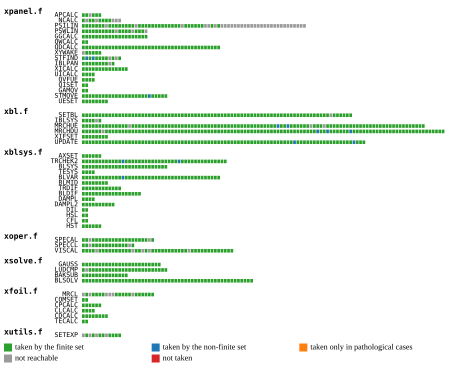

# Branch coverage

--8<-- "validation/branch-coverage/tables/run.md"

## What this study is for

CLAUDE.md Rule 6: "numerically exact" is claimable only over branches that have been exercised. [Coverage](../../development/testing/coverage.md) measures the union over every tracked case; this study asks for the *minimum* set of cases that takes every reachable branch of the analysis path, and compares every case of that set, run as a whole, with its instrumented reference — so that the coverage claim and the equivalence claim are made over the same runs. This is a study: the tests cover each branch with a single step whose route yFoil is observed to follow ([Branch tests](../../development/testing/branch-tests.md), `docs/development/conventions/testing.md`), and this study adds no evidence they rely on.

## Main results

!!! note "Stub — to be written"

    The headline: how many branches of the analysis path the minimal finite set takes, how many only
    non-finite runs reach (each tested as an event), and how many no run has reached yet.

--8<-- "validation/branch-coverage/tables/measured.md"

--8<-- "validation/branch-coverage/tables/status.md"

*Every branch of the analysis path, one row per subroutine in XFOIL's file order: taken by the finite set (green), taken by the non-finite set (blue), taken only in pathological cases (orange), not reachable — annotated unreachable or a never-taken DO-line edge (grey), not taken (red).*

## In this section

| Page | What it shows |
|---|---|
| [Counting branches](counting-branches.md) | Which branches are counted, and what each status (taken, not reachable, not taken) means |
| [The minimal finite set](the-minimal-finite-set.md) | The fewest cases that take every branch any finite run takes, and how closely yFoil follows each of them as a whole run |
| [DO loops](do-loops.md) | Every `DO` loop of the analysis path: whether its body ran, and whether it ever ran out its count |
| [The non-finite set](the-non-finite-set.md) | The runs whose reference goes non-finite, the branches only they take, and the test that replays each |
| [Branches not taken](branches-not-taken.md) | Branches no measured run has taken, and those taken only by pathological runs |
