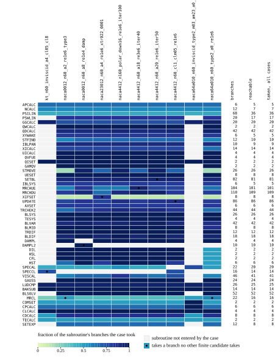

# The minimal finite set

Branches taken by exactly one finite candidate make that candidate essential; the remainder is covered greedily by marginal gain and pruned until no case can be removed. The set is recorded as `group = "branch-coverage"` in `xtask/fixtures-config/cases.toml`, and this study refuses to generate if the two differ. *Branches* is the number of analysis-path edges the case takes; *unique* the ones no other finite candidate takes.

--8<-- "validation/branch-coverage/tables/finite-set.md"

Every case: yFoil generates the panels (`--method cosine`), XFOIL `LOAD`s them (bitwise handoff asserted), one OPER script, one instrumented run plus its five 1-ULP twins.

*Fraction of each subroutine's branches taken by each case of the set; a dot marks a subroutine in which the case takes a branch no other finite candidate takes. The three columns on the right count, per subroutine, every branch, the reachable ones (not annotated unreachable and not a never-taken DO-line edge) and those taken on any measured run, the non-finite set included.*

## Whole-run comparison

Each case of the set is run through yFoil's `Session` exactly as its OPER script drove XFOIL and compared with its fixture by the studies' floor comparison (`studies/study-support/records.rs`; the tests compare single steps instead): iteration count, LVCONV, IST and ITRAN exact; every per-iteration transient and the converged point within `max(tol · scale, FLOOR_FACTOR · floor)`, where *floor* is the reference's own 1-ULP spread of that value; **divergent** when every earlier iteration matched and the reference itself moves by more than `DIVERGENCE_FLOOR` there. The differences are absolute, maxima over the compared calls and iterations. *Worst diff/floor* is the largest difference relative to the reference's own spread of the same value (a value below `FLOOR_FACTOR` = 4 is within tolerance); *ref. 1-ULP spread* is the largest spread the twins showed on the case, per-iteration (viscous) or per-point (inviscid) — when it is large the comparison is only as sharp as the reference itself. † inviscid case: the per-node |ΔGAM| maximum (RMSBL does not exist).

--8<-- "validation/branch-coverage/tables/finite-comparison.md"

## Full polars

The minimal set is single operating points. Full ±30° polars of the aerofoil series and flow regimes
of interest are the [series cases](../series-cases/index.md), and runs that show XFOIL's known issues
are the [known issues](../known-issues/index.md) study.
